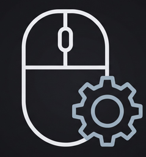

# MouseSetting502



[](https://www.rust-lang.org/)
[](https://slint.dev/)
[](https://microsoft.com/windows)
[](https://github.com/libratbag/libratbag)
[](LICENSE)

Утилита конфигурации проводной мыши Logitech G502 HERO для платформы Windows. Написана на Rust, оснащена графическим интерфейсом на базе фреймворка Slint и интерфейсом командной строки (CLI).

Взаимодействие с контроллером мыши происходит напрямую через системный интерфейс USB HID по протоколу Logitech HID++ 2.0. Приложение не требует установки Logitech G HUB, не развертывает фоновых сервисов, не собирает телеметрию. Настройка мыши работает без сети; вкладка «Сообщество» и проверка обновлений обращаются к GitHub по запросу пользователя.

---

## Версия 2.0.0

Новый тёмный интерфейс: устройства, назначения с двумя ракурсами мыши, подсветка,
DPI, профили и сводка обновлений в «Сообществе». В приложении используются собственный
значок и SVG-иллюстрации мыши. [Все изменения версии](docs/release-v2.0.0.md).

## Совместимость с устройствами

Проверено на **проводной G502 HERO**: VID `0x046D`, PID `0xC08B`, HID++ 2.0
(`0xFF00` / `0x0002`). Другие модели мышей пока не поддерживаются. G435 Lightspeed
определяется при сканировании, настройка гарнитуры не реализована.

---

## Возможности

### Сенсор и DPI
- Настройка чувствительности в диапазоне от 100 до 25 600 DPI с дискретностью 50 DPI.
- Ведение таблицы пресетов для переключения «на лету».
- Привязка функций пошагового изменения чувствительности (DPI Up / DPI Down / DPI Shift) к физическим кнопкам.
- Подтверждённый устройством DPI сохраняется в профиль, для которого была отправлена
  команда. Быстрое переключение профилей не переносит ответ в другой профиль;
  при возврате применяется последнее сохранённое значение.
- Ошибка устройства не меняет сохранённый DPI. Если мышь приняла настройку, но
  запись профиля не удалась, приложение сообщает об этом отдельно.
- Ползунок показывает выбираемое значение, а основной индикатор DPI обновляется
  после ответа мыши. Изменение списка пресетов не меняет текущий DPI само по себе.

### Частота опроса (Report Rate)
- Переключение аппаратных интервалов опроса шины: 125 Гц (8 мс), 250 Гц (4 мс), 500 Гц (2 мс) и 1000 Гц (1 мс).
- Считывание битовой маски поддерживаемых частот по протоколу HID++ (функция `0x8060`) с подтверждением от микроконтроллера.

### Управление RGB-подсветкой
- Задание статического цвета по 24-битному HEX-коду.
- Динамические режимы: пульсация («дыхание») с регулируемым оттенком и спектральный цветовой цикл.
- Настройка периода и яркости эффекта, выбор основной зоны или логотипа, синхронизация зон.
- Выключение выбранной зоны; команда CLI `--off` выключает обе зоны.
- Номер эффекта определяется по ответу устройства. Для программной настройки отключите внутреннюю память.

### Назначение кнопок и макросы
- Перехват аппаратных клавиш (G4–G9, боковые наклоны колеса) через интерфейс `MouseButtonSpy` (`0x8110`) в Host Mode.
- Поддержка одиночных клавиш (включая ряд F1–F24, Space, Escape) и составных модификаторов (Ctrl, Shift, Alt, Win).
- Корректная обработка удержания: раздельные состояния нажатия и отпускания, сохранение общих модификаторов при параллельных действиях.
- Движок макросов на базе Win32 `SendInput` с использованием аппаратных скан-кодов.
- Автоматический сброс активных состояний ввода при смене контекста или остановке макроса.
- Четыре режима: однократный запуск, повтор при удержании, переключатель и
  последовательность с участками нажатия, удержания и отпускания.
- Редактор отдельных нажатий, отпусканий и пауз; запись клавиатуры при фокусе
  редактора и мыши в выделенной зоне. Стандартная задержка заменяет записанные
  интервалы, сохраняя явно добавленные паузы.
- Одновременно выполняется один макрос. Esc, смена профиля, потеря устройства
  и остановка освобождают удерживаемый ввод. Точность задержек зависит от Windows.
- Старые JSON-макросы сохраняют прежнее поведение; база G HUB только читается.
  [Подробности режимов и записи](docs/macros.md).
- Переименование макроса обновляет назначения во всех профилях, а удаление
  очищает все ссылки на него. Изменения сохраняются после переключения профиля
  и перезапуска. После удаления последнего макроса список остаётся пустым.
- При отказе сохранения редактор остаётся открытым и показывает ошибку;
  предыдущие файлы восстанавливаются тем же механизмом отката, что и профили.
  Успешное изменение или удаление работающего макроса останавливает его;
  другой активный макрос продолжает выполняться.

### Встроенная память (Onboard Memory)
- Чтение и переключение аппаратного режима встроенной памяти (`0x8100`).
- Выбор активного профиля из внутренней памяти устройства.
- Программная блокировка циклического переключения профилей по кнопке G9 для исключения случайных переключений во время работы.

### Профили приложения
- Выбранный профиль задаёт имя, назначения кнопок и пресеты DPI, в том числе после
  перезапуска приложения. Отдельный `keybinds.json` обновляется из этого профиля.
- При удалении активного профиля полностью применяется первый оставшийся профиль.
  Удаление неактивного профиля не меняет работающие назначения.
- Создание, копирование и переключение показывают успех только после сохранения.
  При ошибке записи выполняется откат уже изменённых файлов; ошибка самого отката
  сообщается отдельно. Это не транзакция, устойчивая к аварийному завершению процесса.
- Выбор программного профиля и подтверждение DPI мышью имеют отдельные сообщения:
  отсутствие устройства или отказ команды не выдаётся за успешное применение DPI.

### Системная интеграция
- При рабочем трее крестик скрывает окно; пункт «Выход» в меню значка завершает
  приложение. Если создать трей не удалось, крестик завершает приложение.
- При выходе сначала останавливаются перехватчики и макросы, затем приложение
  дожидается завершения начатой операции с мышью и сохранения её результата.
- Опциональная автозагрузка при входе в Windows. Приложение проверяет также отключение записи в Диспетчере задач; после перемещения EXE настройку нужно обновить.
- Проверка целостности исполняемого файла по алгоритму SHA-256 с официальными релизами GitHub.
- Изолированная потоковая модель: обмен HID-пакетами выполняется в выделенном рабочем потоке, что предотвращает блокировку интерфейса.

---

## Использование

### Графический интерфейс

Запуск приложения в обычном режиме открывает главное окно панели управления:

```powershell
.\ghub_rust.exe
```

### Командная строка (CLI)

Для автоматизации, пакетных сценариев или интеграции в сторонние скрипты доступен интерфейс командной строки:

```powershell
# Вывод справочной информации
.\ghub_rust.exe --help

# Проверка последнего релиза GitHub и SHA-256 текущего файла (без обращения к мыши)
.\ghub_rust.exe --check-updates

# Просмотр текущего состояния устройства и активного значения DPI
.\ghub_rust.exe --cli

# Установка уровня DPI
.\ghub_rust.exe --dpi 800

# Управление статической подсветкой (HEX-формат)
.\ghub_rust.exe --color 00FFCC

# Включение эффекта пульсации с заданным цветом
.\ghub_rust.exe --breathe 0088FF

# Включение циклической смены спектра
.\ghub_rust.exe --cycle

# Полное отключение светодиодов
.\ghub_rust.exe --off

# Сканирование шины USB на наличие совместимых устройств Logitech
.\ghub_rust.exe --scan

# Вывод списка макросов и назначений клавиш
.\ghub_rust.exe --macros

# Тестовый запуск макроса по идентификатору
.\ghub_rust.exe --run-macro "burst_click"
```

---

## Архитектура и протокол

Обмен данными с устройством построен на базе протокола Logitech HID++ 2.0:

```
USB HID Interface (Usage Page: 0xFF00, Usage: 0x0002)
│
├── Root Feature (0x0000) ─────── Запрос Feature Index по 16-битному ID
├── Feature Set (0x0001) ──────── Динамическое обнаружение поддерживаемых функций
├── Adjustable DPI (0x2201) ───── Диапазон и текущее разрешение сенсора
├── Report Rate (0x8060) ──────── Битовая маска интервалов и подтверждение частоты
├── Onboard Profiles (0x8100) ─── Режимы памяти и переключение аппаратных слотов
├── MouseButtonSpy (0x8110) ──── Перехват событий нажатия дополнительных кнопок
└── RGB Lighting (0x8070) ── Управление зонами подсветки и аппаратными эффектами
```

Взаимодействие осуществляется через короткие (7 байт, Report ID `0x10`) и длинные (20 байт, Report ID `0x11`) пакеты HID-репортов. Приложение автоматически разрешает индексы функций при инициализации устройства, что обеспечивает переносимость между различными ревизиями прошивки.

---

## Добавление поддержки других устройств

Поддержка новой модели требует определения HID-интерфейса, доступных функций,
кнопок и зон подсветки, а также проверки на реальном устройстве. Добавления PID
недостаточно: команды и формат ответов могут отличаться.

Обнаружение устройств находится в `src/main.rs` и `src/ui/device_connection.rs`,
команды — в `src/hidpp/features/`, схемы мыши и кнопок — в `ui/ghub-controls.slint`
и `ui/assets/mouse-*.svg`. Для чтения возможностей подсветки G502 HERO:

```powershell
cargo run --release --example lighting_info
```

---

## Сборка из исходного кода

### Требования
- Компилятор Rust (редакция 2024, toolchain `stable-x86_64-pc-windows-msvc` или `stable-x86_64-pc-windows-gnu`).
- Windows SDK / Visual Studio C++ Build Tools (для сборки зависимостей `slint-build` и `windows-sys`).

### Инструкция по сборке

```powershell
# Клонирование репозитория
git clone https://github.com/RilleSB/MouseSetting502.git
cd MouseSetting502

# Проверка исходного кода
cargo check

# Запуск набора модульных и интеграционных тестов
cargo test

# Сборка оптимизированного релизного файла
cargo build --release
```

Тесты с файловым хранилищем используют отдельный `tempfile::TempDir` для каждого
сценария и функции с явными путями (`*_from_path`, `*_to_path`,
`delete_profile_by_id_with_paths`). Не вызывайте из тестов операции, которые сами
определяют путь в `%APPDATA%\ghub_rust`: они работают с пользовательскими настройками.
Не меняйте `APPDATA` внутри тестов — переменные окружения общие для параллельных
потоков. Тест автозагрузки использует отдельную временную ветку реестра, а не
пользовательский ключ `Run`.

Сохранение настроек записывает новое содержимое в уникальный временный файл
рядом с целевым, вызывает `sync_all`, затем заменяет целевой файл без его
предварительного удаления. Ошибки создания каталога, записи, синхронизации и
замены возвращаются вызывающему коду; при ошибке до замены старый файл остаётся
на месте. На Windows кратковременные блокировки обрабатываются ограниченными
повторами (до 63 мс суммарной задержки); если блокировка сохраняется, сохранение
завершается ошибкой. Операции записи внутри процесса выполняются последовательно:
побеждает последняя выполненная запись. Контроль версий состояния и согласованное
изменение нескольких файлов остаются задачей вызывающего кода. Метаданные каталога
не синхронизируются, поэтому сохранение не гарантирует устойчивость переименования
к внезапному отключению питания.

Скомпилированный исполняемый файл размещается по пути:
`target\release\ghub_rust.exe`.

---

## Лицензия

Проект распространяется под лицензией [MIT](LICENSE). Разрешено свободное использование, модификация и распространение.
